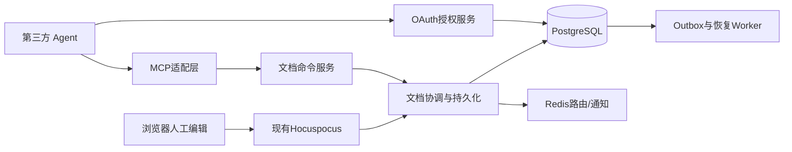

# 架构和现状

## 1. 已审阅证据

| 当前路径（相对仓库根） | 事实 | 必需变化 |
|---|---|---|
| apps/server/src/core/mcp/* | 四个只读工具、/mcp、JwtAuthGuard、空scope兼容 | 保留读取兼容，增加OAuth principal及新工具 |
| core/auth/strategies/jwt.strategy.ts | Cookie优先；API_KEY走IntegrationTokenService | 不直接拿该策略认证OAuth；MCP显式Bearer类型分流 |
| core/page/page.controller.ts / services/page.service.ts | ACL一部分在controller；标题先更新再正文；create无统一外层事务 | 提取可复用命令和事务边界，不能直接沿用当前update当原子命令 |
| collaboration/collaboration.gateway.ts | debounce=10000、maxDebounce=45000 | 防抖仅用于物化/后台任务，不作为Agent成功标准 |
| collaboration/extensions/persistence.extension.ts | 捕获保存错误；以JSON相等跳过；content和ydoc一起写 | 二进制变化必须持久化，错误向命令层传播；snapshot按序压缩 |
| collaboration/extensions/redis-sync/redis-sync.extension.ts | 文档owner TTL；续期SET/释放DEL未比较owner；customEvent回执不是业务持久化票据 | owner登记进PG；Redis compare-token续期/删除；operation_id可重复路由 |
| collaboration/extensions/authentication.extension.ts | beforeHandleMessage检查单用户会话 | 增加beforeSync对入站变更的持久化及文档许可校验 |
| core/editor-session/editor-session.service.ts | Redis key含userId；部分开关可仅告警/关闭 | 原同用户接管保留；增加不可降级的文档级Agent互斥 |
| client/features/editor-session/draft-store.ts | 有IndexedDB恢复草稿写入 | 扩展按workspace/user隔离、读取/删除/恢复提示及配额失败处理 |
| database/repos/page/page-history.repo.ts | insertPageHistory可传trx，历史本体主要JSON | Agent前后快照同步入事务，增加二进制快照及关联 |
| app.module.ts / .gitmodules | ee可选加载，子模块为空 | 不加载官方商业MCP；自主模块在core及features下 |

本地node_modules中SDK 1.29.0的最新协议常量为2025-11-25；Hocuspocus 4.0.0 DirectConnection.transact仅修改live文档，disconnect虽触发store hooks，也不提供本方案的操作原子性。不能根据在线新版本文档假定本地API已有skipStoreHooks等能力。

## 2. 模块边界（拟新增路径）

| 路径 | 主责任 | 禁止承担 |
|---|---|---|
| core/agent-oauth | Client注册、授权请求、grant、token、同源页面BFF | 修改文档、绕过ACL |
| core/mcp | SDK工具schema、协议错误和principal适配 | 直接更新pages/ydoc |
| core/document-command | 幂等、范围鉴权、配额、命令编排 | WebSocket传输、OAuth发token |
| collaboration/services/document-coordinator | 文档门闩、owner fencing、人工许可、候选Y.Doc、journal/checkpoint | 用户授权UI、应用注册 |
| database/repos/agent-*、document-* | 参数化查询和显式事务 | 隐式从HTTP取用户 |
| integrations/queue/新增processor | operation扫描、outbox重投、历史/索引派生 | 绕过命令服务重复执行 |
| client/features/agent-connections | 自建授权页、连接管理及策略 | 导入ee/oauth组件 |

模块依赖为MCP→DocumentCommand→协作服务/页面低层命令；OAuth和协作共享独立principal/授权接口，不能互相导入Module形成循环。现有PageService高层HTTP编排不反向依赖MCP。抽取page create/metadata事务命令是两个真实入口共同需要，不建立通用流程引擎。

PG持有授权、互斥、revision、操作结果与Yjs二进制事实；Redis是加速/通知，不是安全边界。单文档路由到现有Hocuspocus owner，owner重启可从checkpoint+journal重建。浏览器、HTTP标题/正文/恢复、评论mark、导入覆盖、内部AI修改等所有修改Y.Doc的入口都需要进入协调器。页面移动、删除、限制权限虽不开放给Agent，现有网页操作仍需遵守冲突和ACL串行化。

## 3. 数据读取和部署

agent授权与操作查询只读主库，禁止用延迟副本决定权限或committed。普通知识搜索允许索引延迟，但详情和编辑上下文从权威状态或已追平snapshot读取。服务端严格设置workspace上下文，worker不复用前次请求连接状态。

单进程开发与API/Collab分离部署使用相同文档命令接口；单进程直接调用，分离部署使用已有Redis路由信封{operationId,workspaceId,pageId,ownerEpoch}。消息载荷不包含token、任意用户对象或可执行代码；接收者从PG重建principal。PubSub丢包由PG pending扫描恢复，不以消息投递成功当提交。
