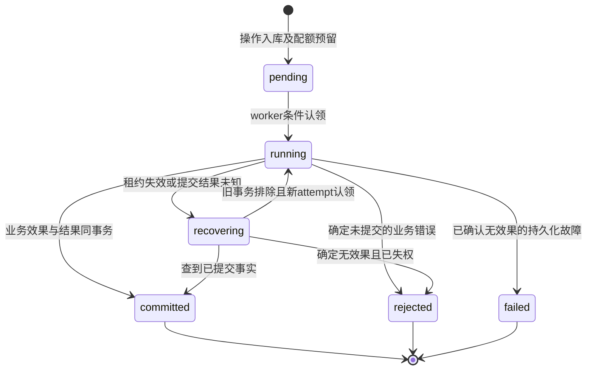
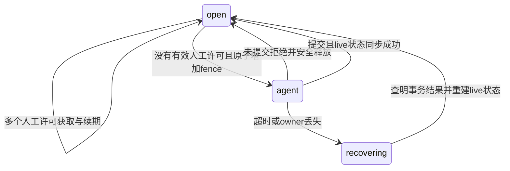

# 状态机

数据库内部running/recovering对Agent均映射pending；get_operation可返回安全phase，但不承诺进度百分比。committed/rejected/failed不可回退。进程超时不得写rejected掩盖未知提交；恢复必须先等待旧数据库事务完成并获取operation行锁。

open并不代表无人编辑，是否可Agent写仍需锁内检查human_permits。所有过期许可按PG时间判断。recovering期间拒绝新写与新人工许可，允许授权的只读与状态查询。60秒为报警/恢复阈值，不是强制释放门闩期限。

grant从active进入revoked/expired后不可恢复；扩权建立新授权，不能修改旧grant来扩大权限。client或workspace禁用使其grant即刻不可用；重新开启不复活显式撤销或过期grant。

人工接管：等待Agent终结→确认gate open→取最新generation/revision→获取permit→同步最新Y.Doc→允许编辑。离线旧草稿只读展示，由用户决定复制或重新应用，不能自动把旧Yjs更新发送到新epoch。原草稿保留至用户明确处理或按既定草稿保留政策清理。

对外恢复状态使用PRD的reconciling（错误/提示码OPERATION_RECONCILING）；数据库内部recovering为实现枚举。纯业务拒绝为rejected，确定无效果的基础设施失败为failed/PERSISTENCE_UNAVAILABLE；提交未知绝不能进入failed。
